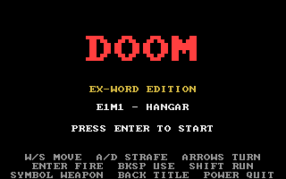
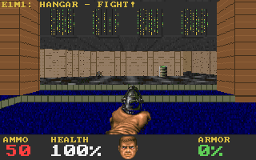
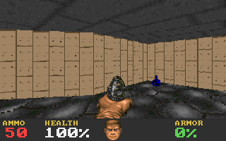
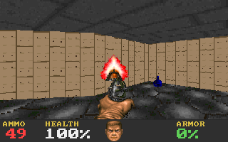

# DOOM-DP9 — DOOM for CASIO EX-word DATAPLUS 9 (`XD-K4800` / `CY700`)

CASIO 電子辞書 **EX-word DATAPLUS 9 (`XD-K4800` / ファームウェア `CY700`)** 上でネイティブ動作するスタンドアロン DOOM エンジン（`.d01` プラグイン / `CASIODICPLUGIN10`）です。

外部 SD カードや追加 WAD ファイルがなくても、`doom.d01`（約 115 KiB）単体に LZSS 圧縮された **E1M1 (Hangar)** マップ・パレット (`PLAYPAL`)・カラーマップ (`COLORMAP`)・床/天井フラット・武器/モンスター/アイテムスプライトを内蔵しており、辞書メニューから単体で起動・プレイできます。

---

## スクリーンショット（レンダラ出力プレビュー）

| タイトル画面 | E1M1 開始部屋（前進・ドラム缶） |
|---|---|
|  |  |

| E1M1 通路旋回・アイテム | 射撃・マズルフラッシュ |
|---|---|
|  |  |

---

## 操作方法（EX-word 実機キーバインド）

| 操作 | キー |
|---|---|
| ゲーム開始 / 射撃（攻撃） | `決定 (ENTER)` / `F` / `Z` |
| 前進 / 後退 | `↑` / `↓` または `W` / `S` |
| 左旋回 / 右旋回 | `←` / `→` または `Q` / `P` |
| 左平行移動 / 右平行移動（ストレイフ） | `A` / `D` |
| ダッシュ（高速移動） | `シフト (SHIFT)` または `R` |
| ドア開閉 / スイッチ / リフト操作 | `削除 (BACKSPACE)` / `E` / `X` |
| 武器切り替え（拳 / ピストル / ショットガン） | `記号 (SYMBOL)` / `ページ↑` / `ページ↓` |
| オートマップ表示切替 | `文字サイズ (ZOOM)` / `M` / `ジャンプ (JUMP)` |
| 無敵モード切替 (`IDDQD`) | `G` |
| 全武器・弾薬・鍵付与 (`IDKFA`) | `V` |
| タイトルへ戻る / 辞書メニューへ終了 | `戻る (BACK)` / `電源 (POWER)` |

---

## DATAPLUS 9 (`XD-K4800` / `CY700`) 固有のハードウェア解析・対応事項

従来の DATAPLUS 5〜7（NOR フラッシュブート世代）向け SDK（`libdataplus` / `libgraphics` / `libexword`）のままでは DATAPLUS 9 (`CY700`) 実機で `.d01` が起動直後にメニューへ弾かれる・あるいはフリーズする問題があったため、実機 OS ダンプ (`CY700_OS.BIN`) の逆アセンブル解析に基づき以下の対応を行っています（詳細は [`docs/PLATFORM.md`](docs/PLATFORM.md) および `sdk_patches/` を参照）：

1. **`libexword` 64-bit Linux 環境での暗号化 XOR 鍵バグ修正 (`sdk_patches/fix_and_install_libexword.sh`)**
   - `libexword` の `src/dict.c` 内で `unsigned long`（64-bit 環境では 8 バイト）を 4 バイト整数と仮定してビットシフトしていたため、`diction.htm` / `infodp*.htm` のアップロード時に暗号化データ（`analys13.cjs` 生成元）が破損していた問題を `uint32_t` 化により修正。
   - `diction.htm`、`infodp3..15.htm`、`infogt3..15.htm` の改行コードを厳密な `CRLF` に統一。
2. **DATAPLUS 9 (`CY700`) の VRAM アドレス (`0xACA00000`) と画面転送システムコール (`0x8C417078`)**
   - 旧世代機の VRAM アドレス `0xAC200000`（物理 `0x0C200000`）は、NAND ブート機の `CY700` では **実行中のメイン OS カーネル領域 (`0x8C000000`–`0x8C58FFFF`)** の非キャッシュエイリアスであり、ここへ書き込むと OS カーネルを破壊して即座にフリーズします。
   - `CY700` の正しい VRAM バッファである **`0xACA00000`** (`528×320` RGB565) を使用し、システムコールディスパッチャ `*(0x74000000) = 0x8C417078` 経由で `sys_0x01(-48, 0, 528, 320)` を呼び出して画面更新を行います。
3. **NAND ブート機向け SDRAM ヒープ配置 (`src/libc/memmgr.c`)**
   - 旧 `memmgr.c` は NOR 領域 `0x8001FF80` の `"CASIODICS"` ヘッダを参照していたため、`CY700`（ヘッダが `0x8C58FF80` に存在）では `pool_size = 0` となり全 `malloc` が失敗していました。
   - また `0x8C800000`〜`0x8C9FFFFF`（OS 変数および `.d01` ロード領域）や `0x8D400000`〜`0x8D7FFFFF`（NAND FTL / DMA バッファ）を避け、OS 未使用のキャッシュ領域 **`0x8D800000`（4 MiB）** にヒーププールを配置しています。
4. **SH-4A 4バイト境界整列 (`sdk_patches/exword.ld`)**
   - `exword_crt0.o` の `.data` 初期化ループ (`mov.l @r5+, r4`) が非整列アドレス例外を起こさないよう、`_etext`, `_ebss`, `_edata` を 4 バイト境界 (`ALIGN(4)`) に整列。
5. **SH-4A CPU ターボクロック & 32-bit 整数レンダラ最適化**
   - `CY700_OS.BIN` (`0x8C0807D0`) と同一の `FRQCR` (`0xA4150000`) シーケンスでゲーム中の CPU クロック分周を引き上げ、終了時に元の省電力設定へ復帰。
   - BSP ノード境界ボックス (`bbox`) 視錐台カリング、セグメント方向ベクトルの事前計算、2行ステップ床スパン描画、VRAM への 32-bit ロングワード転送により、全画面拡大（`480×300` / `528×320` LCD）での軽快な動作を実現。

---

## ビルド済みパッケージのインストール方法

`addons/DOOMX/` にビルド済みのパッケージ一式（`doom.d01` および CRLF 形式の `diction.htm` / `infodp*.htm` / `infogt*.htm`）が含まれています。

パッチ適用済みの `libexword`（`exword` コマンド）を用いて、EX-word 本体をライブラリーモードで USB 接続し、以下のコマンドでインストールできます：

```text
cd addons
exword
>> connect library ja
>> dict auth doomexp 0xE149E149E87FE87FF31CF31CFA34FA34A70FA70F
>> dict remove DOOMX
>> dict install DOOMX
>> disconnect
>> exit
```

---

## ソースからのビルド方法

1. `devkitSH4` (`sh-elf-gcc`) および `libdataplus` を用意し、`sdk_patches/` 内のリンカスクリプト (`exword.ld`) と `fix_libgraphics_cy700.sh` を適用します。
2. ビルドスクリプトを実行します：

```bash
export DEVKITPRO=/opt/exword/devkitPro
export DEVKITSH4=/opt/exword/devkitPro/devkitSH4
make clean && make app
```

---

## ディレクトリ構成

- `src/` — DOOM エンジン本体 (`main.c`, `game.c`, `render.c`, `wad.c`, `embedded_wad.h`)
- `src/libc/` — EX-word SH-4A 向け最小 libc・`CY700` 対応メモリアロケータ (`memmgr.c`)
- `addons/DOOMX/` — 実機インストール用ビルド済みアドオンパッケージ (`doom.d01` ほか)
- `scripts/` — 自動ビルド・USB 転送スクリプト (`build_and_install_doom_cy700.sh`), 埋め込み WAD 生成スクリプト (`gen_embedded_wad.py`)
- `sdk_patches/` — DATAPLUS 9 (`CY700`) 向け SDK・リンカスクリプト・`libexword` 修正パッチ
- `docs/` — `XD-K4800 (CY700)` ハードウェア解析ノート (`PLATFORM.md`)・プレビュー画像
